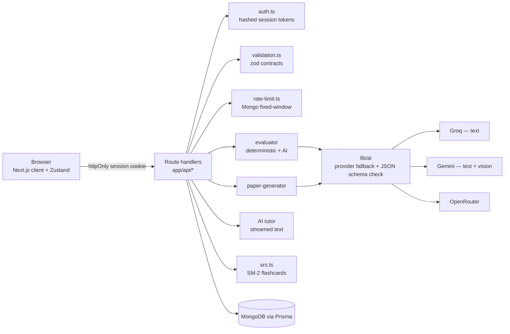

# ExamAce — AI exam practice for CBSE & JEE

[](https://github.com/jateenyadav/Exam-AI/actions/workflows/ci.yml)
   

**Live:** https://exam-ai-tau-bay.vercel.app

[](docs/demo.mp4)

▶ [Watch the full 20-second demo with sound](docs/demo.mp4)

ExamAce generates a full exam paper in the real CBSE / JEE pattern, runs it in a timed, proctored exam room, and grades it — objective questions deterministically, **handwritten answers from a phone photo** with a vision model — then produces a section- and chapter-wise report.


---

## Highlights

| | |
|---|---|
| **Exam patterns** | Class 11 / 12 CBSE, JEE Mains, JEE Advanced (MCQ, assertion-reason, integer, multiple-correct with partial marking, short/long answer, case-based) |
| **AI paper generation** | Built one section per request (so even a 9-section full mock never hits the serverless time limit), every AI response validated against a schema; falls back to an on-subject built-in question bank if AI is down |
| **Handwritten grading** | Photograph your working → vision model grades it against the marking scheme; marks clamped, prompt-injection resistant |
| **Exam room** | Server-enforced deadline, fullscreen + tab-switch detection (counter can only go up), auto-submit |
| **Typed or photographed answers** | Written answers can be typed, photographed, or both — all are graded (photos are compressed in the browser to fit the 2 MB limit) |
| **"Explain my mistake"** | A streamed AI tutor on every graded question, with follow-up questions; falls back to the reference solution if AI is down |
| **Mistake notebook** | Every wrong answer becomes a flashcard scheduled with SM-2 spaced repetition (the algorithm behind Anki) |
| **Weak topics** | Chapter accuracy across all exams → one-click "practice my weak topics" paper |
| **Never lose an exam** | Refresh or crash mid-exam → questions come back from the server, photos from IndexedDB, timer keeps the real deadline |
| **Reports** | Strengths / weaknesses / study plan, print or save as PDF, optional e-mail to student + parent |

## Architecture



Every route is wrapped by `route()` in `lib/http.ts`: request id, one structured JSON log line per request, and uniform errors that never leak internals.

## Security model

ExamAce takes untrusted input from three places — the browser, uploaded photos, and the AI's own output — and treats all three as hostile.

| Threat | Mitigation | Where |
|---|---|---|
| Reading another student's history by typing their e-mail | Identity = session cookie (256-bit random, stored as SHA-256). E-mail is a contact field only | `lib/auth.ts`, `app/api/session` |
| Guessing exam ids (IDOR) | Every handler re-checks `session.studentId === student.id` and returns 404 otherwise | all `app/api/*` |
| Peeking at answers mid-exam | Answer key + solutions are stripped from every response until the exam is finished | `lib/exam.ts → toClientQuestion` |
| Answering after time is up | Server-side deadline (duration + 2 min grace); question must belong to the exam | `app/api/submit-answer` |
| "Award full marks" written on the answer sheet | System prompt treats the image as data, AI output schema-validated, marks clamped to `[0, max]` | `lib/evaluator` |
| Re-grading to farm AI cost / race conditions | Evaluation is idempotent with an atomic `active → completed` claim; unique `(sessionId, questionId)` index | `app/api/evaluate`, `schema.prisma` |
| API-key theft / settings takeover | Secrets live only in env vars; admin status page is read-only behind `ADMIN_TOKEN` (timing-safe compare) | `lib/env.ts`, `app/api/settings` |
| Abuse of the free AI quota | Per-student + global daily paper caps, daily tutor cap, per-IP signup limit — counted with one atomic `findAndModify` so parallel requests can't slip past | `lib/rate-limit.ts` |
| Tutor leaking answers mid-exam | `/api/explain` only works once the exam is finished | `app/api/explain` |
| HTML injection in e-mail reports | Every interpolated value escaped; one e-mail per exam, daily cap | `app/api/send-results` |
| Oversized / malicious uploads | JPEG/PNG/WebP only, ≤ 2 MB, text ≤ 5,000 chars | `lib/validation.ts` |

## AI design

- **Provider fallback** — text goes Groq → Gemini → OpenRouter; photos go to vision models only (Gemini → OpenRouter). A provider "fails" if it errors, times out (`AbortController`), *or* returns JSON that doesn't match the zod schema. An optional time budget stops trying before the serverless limit.
- **Streaming tutor** — `lib/ai/stream.ts` reads OpenAI-style server-sent events from any provider and pipes the text straight to the browser; it only switches provider before the first token.
- **Generation as small steps** — `POST /api/generate-paper` creates the exam (status `generating`), `/section` builds one section (idempotent, safe to retry), `/start` checks every section exists and starts the clock. Answers stay hidden for `generating` exams too.
- **Model is config, not code** — `GEMINI_MODEL` defaults to `gemini-flash-latest`, an alias that tracks Google's current Flash model, so a retired model id can't take the app down.
- **Cost-aware** — sections run with a concurrency cap of 3, written answers with a cap of 4, inside Vercel's 60 s limit; each AI call logs provider, latency and outcome.

## Data model

`Student` · `AuthSession` · `ExamSession` · `Question` · `StudentAnswer` · `ExamResult` · `ReviewCard` · `RateLimit` — enums for mode / status / question type / difficulty, native JSON for options and breakdowns, compound unique on answers, indexes on every foreign key. See [`prisma/schema.prisma`](prisma/schema.prisma).

## Tests

```bash
npm test                  # 65 unit + route tests (scoring, secrecy, IDOR, injection, uploads + retries, SM-2, streaming, weak topics, offline bank)
npm run test:integration  # 22 tests on a real MongoDB replica set: full API flow, atomic rate limit, notebook, v1 → v2 migration
```

CI (GitHub Actions) runs lint → typecheck → unit → integration → production build on every push and PR.

## Run it locally

```bash
npm install
cp .env.example .env.local     # set DATABASE_URL + GEMINI_API_KEY
npx prisma db push             # create collections + indexes
npm run dev                    # http://localhost:3000
```

Without any AI key the app still works: papers come from the built-in question bank and objective questions are graded normally.

### Free AI keys

| Provider | Free tier | Use for |
|---|---|---|
| **Google AI Studio** → [aistudio.google.com/apikey](https://aistudio.google.com/apikey) | Free tier, no card; per-project limits shown in AI Studio | Handwriting photos (vision), and text fallback |
| **Groq** → [console.groq.com/keys](https://console.groq.com/keys) | Free tier, very fast; limits shown in the Groq console | First choice for text (papers, typed answers, reports) |
| **OpenRouter** → [openrouter.ai/keys](https://openrouter.ai/keys) | `:free` models: ~20 req/min, 50 req/day (1,000/day after a one-time $10 credit) | Fallback — set `OPENROUTER_MODEL` to a vision-capable `:free` model |

## Deploy (free)

1. **MongoDB Atlas** M0 cluster → copy the connection string into `DATABASE_URL`.
2. **Vercel** → import the repo, add the env vars from `.env.example`, deploy.
3. Upgrading a v1 database: `DRY_RUN=1 node scripts/migrate-legacy-data.mjs` (report only), then without `DRY_RUN`, then `npx prisma db push`. The script is idempotent and covered by `tests/integration/legacy-migration.test.ts`.

## Trade-offs & next steps

- Answer photos are stored inline (base64, ≤ 2 MB after in-browser compression) to keep the stack to one free service; next step is object storage (S3/R2) with signed URLs.
- Rate limits use MongoDB counters to avoid adding Redis; at higher traffic swap `lib/rate-limit.ts` for Upstash.
- Sessions are device-bound (no password). Adding Google sign-in would let students see their history across devices.
- Grading runs inside the request; a queue (Inngest / QStash) with progress over SSE would remove the 60 s ceiling for very long papers.

---

MIT © Jateen Yadav
